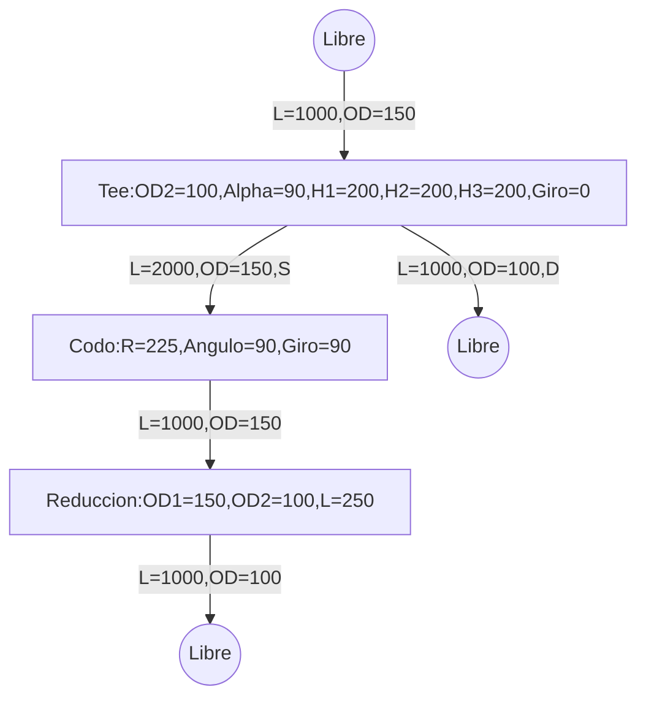

# Mesh_preforma

Generador de mallas 2D (elementos de placa/cáscara) para sistemas de cañerías. Arma mallas estructuradas preestablecidas de **caños, codos, reducciones y tees**, las ubica en el espacio según la topología de la red, las funde en una sola malla y la exporta para usarla en un programa FEM.

## Autores

- Gerónimo Filippi: filippigero@gmail.com
- Reinaldo Raviolo: reiraviolo@gmail.com

## Licencia

MIT, ver [LICENSE](LICENSE).

## Idea principal

Generar mallas preestablecidas para cada componente de cañería y combinarlas en una malla de elementos 2D de una geometría compuesta, para evaluarla luego en un programa FEM (el análisis FEM no forma parte de este proyecto).

## Componentes

| Componente | Parámetros |
|---|---|
| Caño | Diámetro exterior (`OD`), longitud (`L`) |
| Codo | `OD`, radio de curvatura (`R`), ángulo (`Angulo`), giro (`Giro`) |
| Tee | `OD2` (derivación), `Alpha`, `H1` (ingreso), `H2` (salida derivación), `H3` (salida directa), `Giro` |
| Reducción | `OD1` (entrada), `OD2` (salida), longitud (`L`) |

**Variables globales** (necesarias para acoplar las mallas):

- `OD`: diámetro exterior al inicio de la tubería.
- `N`: número de divisiones en la circunferencia.

## Requisitos e instalación

- Python ≥ 3.14 y [uv](https://docs.astral.sh/uv/)
- Dependencias: numpy, matplotlib, ipympl, requests

```
uv sync
```

## Uso

### 1. Línea de comandos

```
uv run python main.py archivo.md [N] [salida.malla]
```

- `N`: divisiones del perímetro del tronco principal (por defecto 24).
- `salida.malla`: por defecto, el nombre del `.md` con extensión `.malla`.

Ejemplo (los archivos de prueba están en `ejemplos/`):

```
uv run python main.py ejemplos/Caso_1.md 48
```

### 2. Interfaz gráfica

```
uv run python mesh_preforma_gui.py
```

## Formato de entrada (Mermaid)



- Nodo libre: `id((Libre))`
- Nodo con accesorio: `id["Tipo:clave=valor,..."]`
- Tramo: `origen -->|clave=valor,...,flag| destino`
- Flags `S` / `D` en los tramos que salen de una Tee: salida directa o derivación.

## Salida: archivo `.malla`

Texto plano con las secciones:

- `MERMAID`: el diagrama de origen, comentado.
- `NODOS`: id y coordenadas x y z.
- `ELEMENTOS`: cuadriláteros (los triángulos repiten el último nodo).
- `SOLDADURAS`: anillos de nodos donde se unen dos piezas.

Además se muestra un gráfico 3D con la malla fusionada, las soldaduras en rojo y los ejes de cada tramo.

## Estructura del proyecto

```
main.py                 punto de entrada (línea de comandos)
mesh_preforma_gui.py    interfaz gráfica
src/
  mermaid_reader.py     lectura del Mermaid
  red.py                posición de las piezas en el espacio
  ensamblador.py        genera y fusiona las piezas
  exportador.py         escritura del .malla
  graficador.py         gráficos 3D
  transformaciones.py   rotaciones y traslaciones
  parts/                tubo.py, codo.py, reduccion.py, tee.py
ejemplos/               redes de ejemplo en Mermaid (Caso_1.md, caso_2.md)
resguardo/              versiones anteriores y material descartado (no se usa)
```
