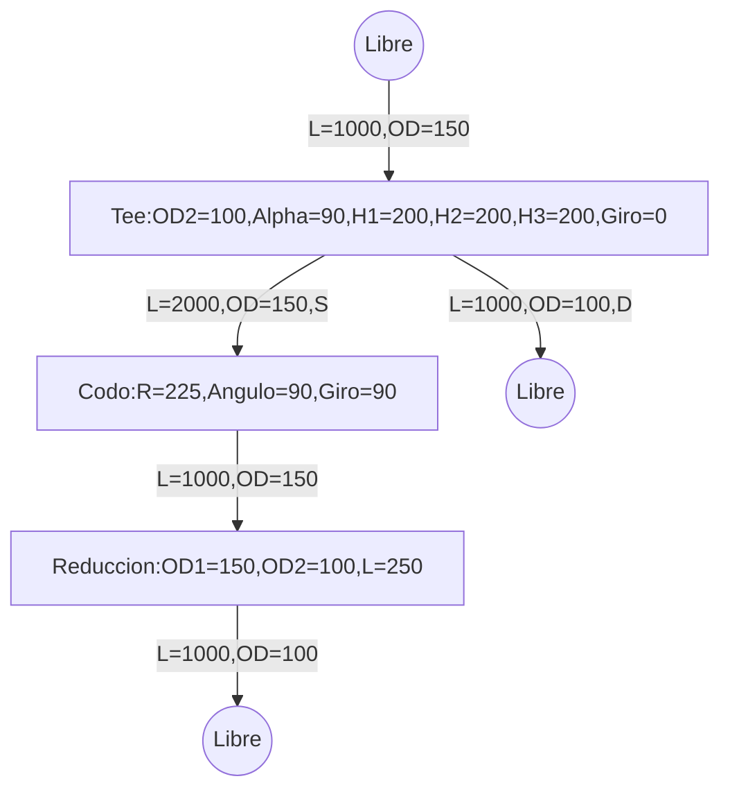

## MESH_PREFORMA:
Programa para mallado en elementos 2D de  sistema de tuberías.

## AUTORES:
Gerónimo Filippi - filippigero@gmail.com
Reinaldo Raviolo - reiraviolo@gmail.com

## LICENCIA: MIT

## IDEA PRINCIPAL:
* Generar mallas pre-establecidas para componentes de cañerias ( tee, codos, reducciones y caños) y luego combinarlos para formar una malla de elementos 2D (placa) de una geometría compuesta a evaluar en un programa FEM ( no alcanzado en este proyecto).

## Partes de tubería a pre-mallar

__Sistema de Piping, variables de componentes pre-establecidos:__
  * Caño: Outside Diameter (OD), Longitud (H)
  * Codo: Outside Diameter (OD), Radio (R), Ángulo (Alpha)
  * Tee: Outside Diameter Directo (OD_1), Outside Diameter Derivación (OD_2), Longitud de ingreso a intersección (L_1), Longitud intersección a salida derivación (L_2), Longitud intersección a salida directa (L_3)
  * Reducción: Outside Diameter Entarda (OD_1), Outside Diameter Salida (OD_2), Longitud (H).

##  Variables globales requeridas para poder acoplar las mallas
* OD = Outside Diameter al inicio de la tubería.
* N = Número de divisiones en la circunferencia.

## ¿COMO CORRER?

__Hay dos maneras de correr el programa__

* Mediante un archivo *.md que carga un mermaid (ejemplo a continuación):

* Luego: 

uv run python main.py "archivo de entrada.md" "Número de divisiones en circunferencia"

Ej: uv run python main.py Caso_1.md 48

* Mediante entorno gráfico corriendo en terminal:

__uv run python mesh_preforma_gui.py__

